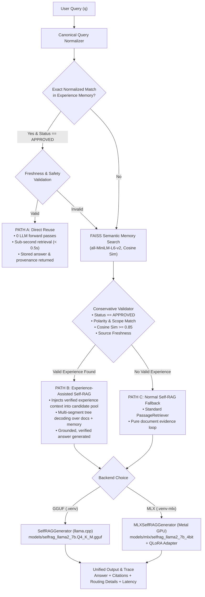

# EvoRAG: Evolutionary Retrieval-Augmented Generation with Hybrid Experience Learning

[](#10-running-automated-tests)
[](#7-installation--environment-setup)
[-orange.svg)](#5-fine-tuned-apple-silicon-mlx-qlora-model)
[](#12-task-12g-frozen-benchmark-results)

**EvoRAG** extends the [Self-RAG](https://arxiv.org/abs/2310.11511) framework (Asai et al., ICLR 2024) with **Hybrid Experience Learning** and **Apple Silicon MLX QLoRA domain adaptation**. It couples an episodic, persistent Experience Memory subsystem with adaptive reflection-token-driven retrieval, enabling continuous learning, reduced inference volume, sub-second direct reuse, and domain-specialized technical generation on local Apple Silicon hardware.

---

## 1. Project Overview & Motivation

Standard Self-RAG evaluates retrieval dynamically per segment and critiques candidate continuations using reflection tokens (`[Relevant]`, `[Fully supported]`, `[Utility:N]`). While effective, it suffers from two major limitations in production:
1. **Redundant Inference & High Latency**: Identical or semantically near-identical questions re-run expensive multi-segment tree decoding from scratch every single time.
2. **Stateless Generation**: Verified high-quality answers and reasoning paths discovered by the model are discarded immediately after generation, failing to benefit subsequent queries.

**EvoRAG solves this by combining:**
- **Persistent Experience Memory**: Stores human- or expert-verified question-answer pairs with source chunk provenance in SQLite, indexed by dense vector embeddings in FAISS.
- **Three-Path Routing Engine**: Routes incoming queries to Path A (instant direct reuse), Path B (experience-assisted tree decoding), or Path C (standard Self-RAG fallback).
- **Apple Silicon MLX QLoRA**: Local 4-bit domain fine-tuning of the Self-RAG 7B model on Apple M-series chips, delivering high precision on technical domains (DBMS & SQL) without cloud GPU dependence.

---

## 2. EvoRAG Architecture



For complete mathematical definitions and validator heuristics, see [`docs/ARCHITECTURE.md`](docs/ARCHITECTURE.md).

---

## 3. Comparison: Normal RAG vs Self-RAG vs EvoRAG

| Capability | Normal RAG (Gemini) | Original Self-RAG (GGUF) | EvoRAG (GGUF) | Fine-Tuned EvoRAG (MLX) |
| :--- | :---: | :---: | :---: | :---: |
| **Adaptive Retrieval Control** | ❌ Always retrieves | ✅ Reflection probe (`[Retrieval]`) | ✅ Reflection probe | ✅ Reflection probe |
| **Passage Self-Critique** | ❌ External model | ✅ `ISREL`, `ISSUP`, `ISUSE` | ✅ `ISREL`, `ISSUP`, `ISUSE` | ✅ Atomic token-ID stopping |
| **Repeated Query Optimization** | ❌ Re-runs LLM | ❌ Re-runs LLM | ✅ Path A Direct Reuse (0 LLM calls) | ✅ Path A Direct Reuse (0 LLM calls) |
| **Continuous Learning** | ❌ None | ❌ Stateless | ✅ Episodic SQLite + FAISS | ✅ Episodic Memory + QLoRA |
| **Hardware Requirement** | Cloud API Key | 8 GB CPU/RAM | 8 GB CPU/RAM | Apple Silicon Metal GPU (16+ GB) |
| **Model Load Time** | N/A (API) | 10.53s | 10.53s | **0.65s** (>16x faster) |
| **Token Precision (Benchmark)** | 0.3011 | 0.2294 | 0.2404 | **0.3265** (Highest overall) |

---

## 4. Experience Memory and Three-Path Routing

The Experience Memory subsystem operates through three distinct execution paths:

1. **Path A (Exact Direct Reuse)**:
   - Activated when a query normalizes identically to an approved experience (`normalize_question(q) == normalize_question(q_exp)`).
   - Verifies that cited source documents have not changed since verification.
   - Bypasses the LLM entirely, returning the approved answer and provenance in $< 500$ ms.
2. **Path B (Experience-Assisted Self-RAG)**:
   - Activated when candidate experiences meet the cosine similarity threshold ($\ge 0.85$) and pass conservative validation (polarity, question dimension, and scope checks).
   - Injects the proven experience text into the document candidate pool.
   - Guides the model along verified reasoning trajectories while generating an up-to-date answer.
3. **Path C (Normal Self-RAG Fallback)**:
   - Activated when no candidate experiences exist or validation fails.
   - Executes standard Self-RAG multi-segment retrieval over the underlying document corpus.

---

## 5. Fine-Tuned Apple Silicon MLX QLoRA Model

EvoRAG includes an experimental local fine-tuned backend designed specifically for Apple Silicon Macs:

- **Base Checkpoint**: `selfrag/selfrag_llama2_7b` converted to MLX 4-bit group quantization (`models/mlx/selfrag_llama2_7b_4bit/`).
- **Special Token Preservation**: Preserves all 16 Self-RAG special tokens as atomic token IDs (32000–32015).
- **Training Corpus**: 182 approved DBMS examples across 13 core categories trained on Apple M3 Pro Metal GPU for 3 epochs (546 steps). Validation loss dropped from 6.4219 to **0.8713** (Perplexity: 2.39).
- **Atomic Token-Level Stopping**: Enforces immediate stopping on `[Utility:1..5]` (IDs 32007–32011) and greedy retrieval decision probes without truncating partial tokens.
- **Metal Efficiency**: Consumes **3.79 GB** of unified memory; loads in **0.65s**.

---

## 6. Project Directory Structure

```
self-rag-demo/
├── demo.py                          # Unified CLI entry point (all 4 modes)
├── evorag_cli.py                    # Dedicated EvoRAG terminal CLI
├── requirements.txt                 # Production dependencies (.venv)
├── pytest.ini                       # Test configuration and markers
├── data/                            # Source data & Experience Memory
│   ├── experience_memory.db         # SQLite persistent Experience Store (25 approved)
│   ├── experience_faiss.index       # FAISS vector index over experience questions
│   ├── experience_meta.json         # Experience index metadata & ID mapping
│   └── dbms_training_experiences.jsonl # Training experiences dataset
├── docs/                            # In-depth architectural & operational guides
│   ├── ARCHITECTURE.md              # Detailed technical architecture specification
│   ├── SETUP.md                     # Environment setup & model prerequisites
│   ├── USAGE.md                     # Comprehensive CLI & demonstration guide
│   ├── EVALUATION.md                # Task 12G frozen benchmark evaluation & ablation
│   └── DBMS_CORPUS.md               # 15-document DBMS corpus specification
├── EvoRAG_DBMS_SQL_15_Document_Corpus/ # Educational DBMS document corpus (15 PDFs)
├── EvoRAG_Blind_Test_Questions/     # 32 held-out test questions (Frozen benchmark)
├── EvoRAG_Answer_Key_For_Frozen_Run/# Official verified answer key (Frozen benchmark)
├── index/                           # FAISS document indices
│   ├── dbms_sql_v1/                 # Dedicated 15-PDF DBMS corpus index (232 chunks)
│   └── corpus.jsonl / faiss.index   # Baseline sample index
├── models/                          # Local model storage
│   ├── selfrag_llama2_7b.Q4_K_M.gguf # Production GGUF model (3.80 GiB)
│   └── mlx/selfrag_llama2_7b_4bit/  # Converted MLX 4-bit base model (3.53 GiB)
├── evorag/                          # EvoRAG core package
│   ├── controller.py                # Three-path routing & persistence controller
│   ├── mlx_generator.py             # Apple Silicon MLX QLoRA generator backend
│   └── memory/                      # Store, retriever, validator, index builder
├── normal_rag/                      # Normal RAG baseline (Gemini API)
├── selfrag/                         # Original Self-RAG control loop (Algorithm 1)
├── retriever/                       # Dense passage retriever (SentenceTransformers + FAISS)
├── training/qlora_dbms/             # Local MLX QLoRA training pipeline & reports
│   ├── adapters/full_dbms_v1/       # 3-epoch trained QLoRA adapter weights
│   ├── TASK12E_FULL_TRAINING_REPORT.md # Training run telemetry & curves
│   └── TASK12G_FINAL_EVALUATION_REPORT.md # Final 5-system benchmark report
└── tests/                           # Automated test suites (138 tests)
    ├── test_unified_cli.py          # Unified CLI test suite
    ├── test_mlx_generator.py        # MLX generator integration tests
    ├── test_task10_real_model_warm_cache.py # Warm-cache validation
    └── test_task9b_learning.py      # Experience memory & ingestion tests
```

---

## 7. Installation & Environment Setup

EvoRAG maintains two cleanly separated virtual environments:

### Environment 1: Production GGUF Environment (`.venv`)
```bash
# 1. Create and activate Python 3.13 environment
python3.13 -m venv .venv
source .venv/bin/activate

# 2. Install dependencies
pip install --upgrade pip
pip install -r requirements.txt

# 3. Enable Metal GPU acceleration in llama-cpp-python
CMAKE_ARGS="-DGGML_METAL=on" pip install --force-reinstall --no-cache-dir llama-cpp-python
```

### Environment 2: Experimental MLX Environment (`.venv-mlx`)
```bash
# 1. Create and activate Python 3.12 environment (native ARM64)
arch -arm64 python3.12 -m venv .venv-mlx
source .venv-mlx/bin/activate

# 2. Install MLX packages
pip install --upgrade pip
pip install mlx==0.32.4 mlx-lm==0.32.2
pip install sentence-transformers faiss-cpu pypdf pyyaml pytest
```

For complete setup instructions, see [`docs/SETUP.md`](docs/SETUP.md).

---

## 8. Model Prerequisites

1. **Production GGUF Model**:
   - Location: `models/selfrag_llama2_7b.Q4_K_M.gguf`
   - Size: 3.80 GiB
   - SHA-256: `fb39ef3293bffcac2c44415123ec14d7b62c5cdc46a5dbfab9cf3830afe7dc03`
2. **MLX 4-bit Base Model**:
   - Location: `models/mlx/selfrag_llama2_7b_4bit/`
   - Size: 3.53 GiB
   - SHA-256: `71576febb874c07b71697976f0892c2bab9e972e77bc880dcc0210eb6342db32`
3. **Fine-Tuned MLX QLoRA Adapter**:
   - Location: `training/qlora_dbms/adapters/full_dbms_v1/`
   - Size: 38.15 MB (`adapters.safetensors`)

---

## 9. Launching the Four Execution Modes

You can run any mode through the unified CLI:

```bash
# Interactive menu:
python demo.py
```

### Direct CLI Commands:
```bash
# Mode 1: Normal RAG (Gemini API)
python demo.py --mode normal "What is write-ahead logging in database systems?"

# Mode 2: Baseline Self-RAG (GGUF via llama.cpp)
python demo.py --mode selfrag "What is a B-tree index in PostgreSQL?"

# Mode 3: EvoRAG with GGUF + Experience Memory
python demo.py --mode evorag "How does physical data independence protect applications from storage modifications?"

# Mode 4: Fine-Tuned EvoRAG with Apple Silicon MLX QLoRA
python demo.py --mode evorag-mlx "What is the purpose of a buffer manager?"

# Verbose reflection trace (displays candidate critique scores):
python demo.py --mode evorag-mlx -v "What are ACID properties?"

# Five-System Live Comparison (evaluates 1 question across all 5 systems):
python demo.py --compare
# Or non-interactive:
python demo.py --compare --question-type pdf --question "What is write-ahead logging (WAL) in database systems?"
python demo.py --compare --question-type general --question "What is the capital of France?"
```

> [!NOTE]
> The `--compare` command executes an interactive live demonstration comparing latency and outputs across all 5 systems on exactly one question. For formal, frozen 32-question benchmark results, see [Section 12](#12-task-12g-frozen-benchmark-results).

> [!TIP]
> The unified CLI includes auto-dispatching: running `python demo.py --mode evorag-mlx` while in `.venv` automatically routes to `.venv-mlx` via native ARM64 subprocess.

For full CLI options and arguments, see [`docs/USAGE.md`](docs/USAGE.md).

---

## 10. Running Automated Tests

Run the model-free and integration test suites:

```bash
# In production environment (.venv):
source .venv/bin/activate
HF_HUB_OFFLINE=1 pytest tests/test_unified_cli.py tests/test_task10_real_model_warm_cache.py tests/test_task9b_learning.py

# In MLX environment (.venv-mlx):
source .venv-mlx/bin/activate
HF_HUB_OFFLINE=1 pytest tests/test_unified_cli.py tests/test_mlx_generator.py
```

---

## 11. Example Questions & Behaviors

1. **Path A (Exact Direct Reuse)**:
   - Query: `"How does physical data independence protect applications from storage modifications?"`
   - Outcome: Matches verified experience `3239b9d1ea3f...` with similarity `1.0000`. Returns the stored answer in $< 0.5$s without invoking the LLM.
2. **Path B (Experience-Assisted Self-RAG)**:
   - Query: `"Explain how a buffer pool manager handles disk page caching in DBMS."`
   - Outcome: Matches candidate `DBMS-TRAIN-0015` with similarity $\ge 0.85$. Injects verified memory passages alongside document passages into Self-RAG.
3. **Path C (Normal Self-RAG Fallback)**:
   - Query: `"What are the operational trade-offs of hash index vs B-tree index in PostgreSQL?"`
   - Outcome: No sufficiently similar candidate in memory. Performs standard multi-segment document retrieval over the 15 DBMS PDFs.
4. **Direct Parametric Answer**:
   - Query: `"What is 2 + 2?"`
   - Outcome: The model emits `[No Retrieval]` during the initial probe and generates `"4"` without fetching external documents.

---

## 12. Task 12G Frozen Benchmark Results

The frozen benchmark (`20261109_151957Z`) evaluates all five systems on 32 held-out DBMS questions:

| System Configuration | Token F1 | Token Precision | Token Recall | Citation F1 | Citation Prec | Citation Rec | Mean Latency | Median Latency | P95 Latency | Memory Hits |
| :--- | :---: | :---: | :---: | :---: | :---: | :---: | :---: | :---: | :---: | :---: |
| **System A: Normal RAG** *(Frozen baseline)* | **0.3270** | 0.3011 | **0.4155** | 0.6445 | 0.5639 | **0.8667** | **1,664.2 ms** | **1,600.9 ms** | **2,299.8 ms** | 0 / 32 |
| **System B: GGUF Self-RAG** *(Frozen baseline)* | 0.2209 | 0.2294 | 0.2939 | 0.5267 | 0.4500 | 0.7333 | 13,572.9 ms | 11,949.5 ms | 24,949.2 ms | 0 / 32 |
| **System C: GGUF EvoRAG (Warm)** *(Task 10)* | 0.2365 | 0.2404 | 0.3182 | **0.6556** | **0.7000** | 0.6333 | 15,087.3 ms | 14,165.4 ms | 25,860.8 ms | 5 / 32 |
| **System D: MLX Self-RAG (No Mem)** *(Ablation)* | 0.2528 | 0.2974 | 0.2420 | 0.6222 | 0.6667 | 0.6000 | 10,442.8 ms | 9,980.1 ms | 19,856.3 ms | 0 / 32 |
| **System E: MLX EvoRAG (With Mem)** *(Full)* | **0.2721** | **0.3265** | 0.2539 | 0.6222 | 0.6667 | 0.6000 | **11,062.4 ms** | **10,444.8 ms** | **19,876.7 ms** | 5 / 32 |

### Key Benchmark Takeaways:
1. **Token Precision Leadership**: System E achieved **0.3265**, the highest precision of all 5 systems (+42.3% relative over baseline GGUF Self-RAG, and higher than Normal RAG).
2. **Statistically Significant Memory Gain**: 1,000 paired bootstrap resamples between System E and System D show a verified positive effect: **Mean $\Delta = +0.0192$ Token F1 (95% CI: `[+0.0043, +0.0391]`, $p < 0.05$)**.
3. **Full System Gain**: System E improves over baseline GGUF Self-RAG by **+23.2% relative** (**Mean $\Delta = +0.0512$ Token F1, 95% CI: `[+0.0045, +0.0993]`, $p < 0.05$)**.
4. **Honest Trade-Offs**: Normal RAG (Gemini) maintains higher Token F1 (0.3270) and Recall (0.4155) due to verbose prose generation, but lacks adaptive reflection control and local execution.
5. **Efficiency**: MLX loads in **0.65s** vs 10.53s for GGUF and delivers **26.7% faster** inference than GGUF EvoRAG.

For full evaluation curves, bootstrap tables, and per-question breakdowns, see [`docs/EVALUATION.md`](docs/EVALUATION.md).

---

## 13. Known Limitations

1. **Token Recall Trade-Off**: Fine-tuned MLX generation produces concise, highly focused answers (reflected in high precision 0.3265), which results in lower token recall (0.2539) compared to verbose API models like Gemini (0.4155).
2. **Apple Silicon Hardware Prerequisite**: The experimental MLX generator (`evorag-mlx`) requires macOS and an Apple Silicon M-series chip (Metal GPU). Systems without Metal must use the GGUF backend (`evorag` or `selfrag`).
3. **Dual Virtual Environments**: Due to package dependencies (`llama-cpp-python` vs `mlx-lm`), GGUF and MLX run in separate virtualenvs (`.venv` and `.venv-mlx`), bridged via the unified CLI auto-launcher.

---

## 14. Troubleshooting

- **`Failed to create Metal shared event`**:
  - *Cause*: Running MLX inside an overly restricted sandbox without Metal event access.
  - *Fix*: Run the command in standard macOS user shell or ensure Metal GPU permissions are enabled.
- **`ModuleNotFoundError: No module named 'llama_cpp'` in `.venv-mlx`**:
  - *Cause*: Trying to run GGUF mode directly within the MLX environment without auto-dispatch.
  - *Fix*: Use `python demo.py --mode selfrag` (auto-dispatches to `.venv`), or run `.venv/bin/python demo.py --mode selfrag`.
- **`Hugging Face Connection Timeout` in offline mode**:
  - *Cause*: `sentence-transformers` checking remote hub when offline.
  - *Fix*: Set `export HF_HUB_OFFLINE=1` in your shell to use local cached weights.
