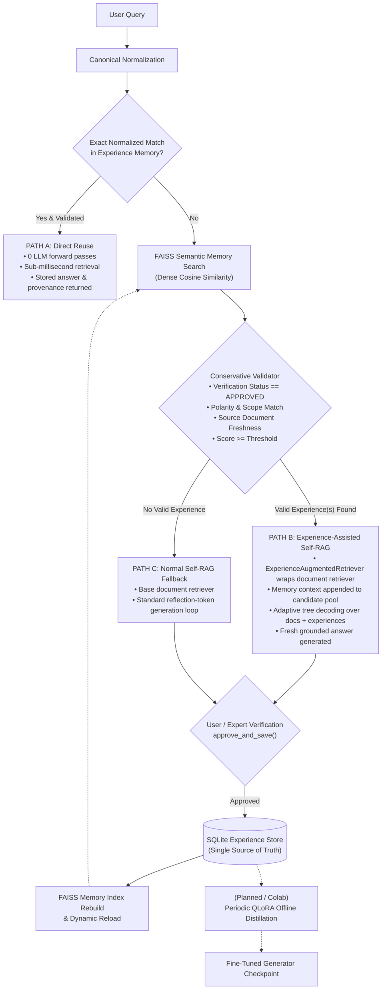

# EvoRAG: Evolutionary Retrieval-Augmented Generation with Hybrid Experience Learning

[](#running-automated-tests)
[](#installation--setup)
[](#evorag-architecture)

**EvoRAG** extends the [Self-RAG](https://arxiv.org/abs/2310.11511) framework (Asai et al., ICLR 2024) with **Hybrid Experience Learning**. It integrates an episodic, persistent Experience Memory subsystem with adaptive reflection-token-driven retrieval, enabling continuous learning, reduced generation costs, and fast query resolution while preserving factuality and provenance.

---

## 1. Motivation & Overview

Standard Self-RAG evaluates retrieval dynamically per segment and critiques candidate continuations using reflection tokens (`[Relevant]`, `[Fully supported]`, `[Utility:N]`). While effective, it suffers from two major limitations in production and repeated query workloads:
1. **Redundant Inference & High Latency**: Identical or semantically near-identical questions re-run expensive multi-segment tree decoding from scratch every single time.
2. **Stateless Generation**: Verified high-quality answers and reasoning paths discovered by the model are discarded immediately after generation, failing to benefit subsequent queries.

**EvoRAG solves this by introducing a three-path hybrid architecture**:
- **Path A (Exact Direct Reuse)**: If a query exactly matches a verified experience, EvoRAG serves the stored answer instantly without calling the LLM (0 inference cost, sub-second latency).
- **Path B (Experience-Assisted Self-RAG)**: If a query is semantically related to verified experiences, those experiences are injected as structured context into Self-RAG's candidate generation pool, guiding the model toward proven reasoning paths while generating a fresh, grounded answer.
- **Path C (Normal Self-RAG Fallback)**: If no verified experiences exist or validation fails (e.g. modified source documents, polarity or scope mismatch), the system falls back safely to standard Self-RAG document retrieval.
- **Continuous Learning Loop**: Newly generated answers that receive user verification are approved and persisted to SQLite, updating the semantic FAISS index for future queries, with periodic QLoRA fine-tuning planned for offline model consolidation.

---

## 2. EvoRAG Architecture



For complete mathematical definitions, validator heuristics, and failure handling, see [docs/EXPERIENCE_MEMORY.md](docs/EXPERIENCE_MEMORY.md).

---

## 3. Technology Stack

| Component | Technology | Role in EvoRAG |
| :--- | :--- | :--- |
| **Experience Store** | SQLite 3 | Single source of truth for persistent verified experiences, source versions, and chunk hashes. |
| **Memory Vector Index** | FAISS (`IndexFlatIP`) | Dense vector similarity index over normalized question embeddings for semantic candidate retrieval. |
| **Embeddings** | `sentence-transformers` (`all-MiniLM-L6-v2` / `bge-small-en-v1.5`) | L2-normalized 384-dimensional dense embeddings for document passages and questions. |
| **Document Retrieval** | FAISS + `PassageRetriever` | Segment-level document passage retrieval over chunked source PDFs. |
| **Self-RAG Generator** | `llama-cpp-python` / `vLLM` | Execution of `selfrag_llama2_7b.Q4_K_M.gguf` emitting reflection tokens (`[Retrieval]`, `[Relevant]`, etc.). |
| **Baseline Normal RAG** | `google-genai` SDK | Gemini API baseline used for side-by-side comparison in `demo.py` and evaluation. |
| **Testing & CI** | `pytest` | 101 automated regression, integration, real FAISS, and real Self-RAG model tests. |

---

## 4. Repository Structure

```
Self-Rag/
├── data/                         # Source documents (place PDFs here)
│   ├── sample.pdf                # 1-page Amazon rainforest note
│   └── 2310.11511v1.pdf          # Self-RAG original research paper
├── docs/                         # Detailed architecture and audit documentation
│   ├── BASELINE.md               # Hardware feasibility, Self-RAG baseline audit, execution guide
│   ├── EXPERIENCE_MEMORY.md      # Detailed Experience Memory specification, retrieval budget, provenance
│   └── SELFRAG_INTEGRATION.md    # Task 7B actual Self-RAG model integration and validation
├── evorag/                       # ── EvoRAG Hybrid Learning Subsystem ──
│   ├── __init__.py               # Exports controller, results, and memory adapter
│   ├── config.py                 # Default paths, thresholds, and dimensions
│   ├── controller.py             # EvoRAGController: three-path routing, provenance, recoverable persistence
│   ├── result.py                 # EvoRAGResult, ExperienceCandidate, ValidationResult dataclasses
│   └── memory/                   # Experience Memory modules
│       ├── __init__.py           # Memory exports
│       ├── index_builder.py      # ExperienceIndexBuilder: rebuilds FAISS index from SQLite
│       ├── retriever.py          # ExperienceRetriever & ExperienceAugmentedRetriever
│       ├── schema.py             # Experience dataclass, SQLite schema, question normalization
│       ├── store.py              # ExperienceStore: SQLite persistent storage & indexed queries
│       └── validator.py          # ExperienceValidator: polarity, numeric/interrogative scope, freshness
├── index/
│   ├── build_index.py            # PDF -> sentence splitter -> passage chunks -> FAISS index
│   ├── corpus.jsonl              # Generated document corpus with chunk hashes & source versions
│   ├── faiss.index               # Generated document FAISS vector index
│   └── meta.json                 # Document index metadata (source PDF byte hashes)
├── retriever/
│   └── retriever.py              # Shared PassageRetriever for document FAISS index
├── selfrag/                      # ── Original Self-RAG pipeline ──
│   ├── generator.py              # llama.cpp / vLLM backends with official prompt format
│   ├── pipeline.py               # Self-RAG control loop (Algorithm 1 multi-segment tree decoding)
│   ├── query_normalizer.py       # Decouples search queries from instructions
│   └── reflection_tokens.py      # Reflection token vocabulary, parsing, critique scoring
├── normal_rag/                   # ── Baseline Normal RAG pipeline ──
│   ├── generator.py              # GeminiGenerator via google-genai SDK
│   └── pipeline.py               # Standard retrieve-then-generate baseline
├── comparison/
│   └── runner.py                 # Side-by-side execution and latency comparison
├── evaluation/
│   ├── evaluate.py               # Batch evaluation CLI (with UTF-8 BOM support)
│   ├── metrics.py                # Latency, chunk count, and length metrics
│   └── questions.json            # 4-category evaluation benchmark
├── tests/                        # ── Automated Test Suite (101 passing tests) ──
│   ├── test_actual_selfrag_integration.py # 6 tests: actual Self-RAG 7B model integration (Paths A, B, C, reflection tokens, learning loop)
│   ├── test_chunker.py           # 12 tests: sentence splitting, abbreviations, chunk construction
│   ├── test_controller.py        # 24 tests: three-path routing, provenance extraction, budget, recovery
│   ├── test_evaluation.py        # 2 tests: UTF-8 BOM and standard JSON loading
│   ├── test_memory.py            # 16 tests: SQLite persistence, FAISS mapping, validation heuristics
│   ├── test_model_free_validation.py # 14 tests: end-to-end model-free pipeline validation
│   ├── test_provenance.py        # 8 tests: deterministic chunk hashing, PDF byte hashing
│   ├── test_real_faiss_integration.py # 16 tests: real FAISS vector search & SentenceTransformer integration
│   └── test_retriever.py         # 3 tests: document PassageRetriever and pipeline compatibility
├── evorag_cli.py                 # EvoRAG Terminal CLI (query, memory lookup, approval flow)
├── demo.py                       # Unified comparison demo CLI (Normal RAG vs Self-RAG)
├── requirements.txt              # Core dependencies + google-genai + python-dotenv
├── requirements-mac.txt          # + llama-cpp-python for Apple silicon
└── requirements-gpu.txt          # + vLLM for Linux + NVIDIA GPUs
```

---

## 5. Implementation Status

| Stage / Component | Status | Verification State |
| :--- | :---: | :--- |
| **Task 1: UTF-8 BOM Handling** | **Completed** | Verified with automated tests in `tests/test_evaluation.py`. |
| **Task 2: Robust Sentence Splitting** | **Completed** | Verified: legal/numeric abbreviations (`Sec.`, `Art.`, `No.`, `Rs.`) intact (`tests/test_chunker.py`). |
| **Task 3: Deterministic Provenance** | **Completed** | Verified: SHA-256 chunk hashing and PDF byte-level `source_version` (`tests/test_provenance.py`). |
| **Task 4: Baseline Audit & Feasibility** | **Completed** | Documented in `docs/BASELINE.md`. Hardware bounds verified for Windows GTX 1650 / 16GB RAM. |
| **Task 5: Experience Memory Subsystem** | **Completed** | Verified: SQLite store, FAISS index builder, retriever, conservative validator (`tests/test_memory.py`). |
| **Task 6: EvoRAG Controller** | **Completed** | Verified: Routing, fallback, direct reuse, explicit approval flow (`tests/test_controller.py`). |
| **Task 6A: Hybrid Experience Learning** | **Completed** | Verified: Three-path routing (Path A, B, C) and `ExperienceAugmentedRetriever` adapter. |
| **Task 6B: Integration Stabilization** | **Completed** | Verified: Original provenance extraction, retrieval budget semantics, recoverable persistence (`recover_index`). |
| **Task 6C: Documentation & Reproducibility Audit** | **Completed** | Verified repository docs, execution boundaries, and reproducibility instructions. |
| **Task 7A: Model-Free End-to-End Validation** | **Completed** | Verified real document extraction/chunking, SQLite memory, validator heuristics, augmented retrieval, 3-path routing, and CLI ([docs/MODEL_FREE_VALIDATION.md](docs/MODEL_FREE_VALIDATION.md)). |
| **Task 7A.1: Real FAISS & SentenceTransformer** | **Completed** | Verified real `faiss-cpu` vector search, real `all-MiniLM-L6-v2` embeddings, SQLite resolution, and recovery (`tests/test_real_faiss_integration.py`). |
| **Task 7B: Actual Self-RAG Model Integration** | **Completed** | Verified real 7B GGUF model integration, reflection tokens, all 3 paths (A, B, C), and continuous learning (`tests/test_actual_selfrag_integration.py`). |
| **Periodic QLoRA Offline Distillation** | *Pending* | Planned future phase on Google Colab / GPU clusters. |
| **Indian Legal Corpus Integration** | *Pending* | Planned future phase (currently using sample.pdf and research paper). |

---

## 6. Onboarding & Getting Started

### Prerequisites
- Python 3.10, 3.11, or 3.12 (developed and tested on Python 3.12.6, Windows x64).
- Git.
- 4 GB+ free disk space if running local embeddings and unit tests.

### Step 1: Clone the Repository
```bash
git clone https://github.com/YourUsername/Self-Rag.git
cd Self-Rag
```

### Step 2: Create and Activate a Virtual Environment
```bash
# Windows PowerShell:
python -m venv venv
.\venv\Scripts\Activate.ps1

# Linux / macOS:
python3 -m venv venv
source venv/bin/activate
```

### Step 3: Install Dependencies
```bash
# 1. Install core dependencies (retriever, FAISS CPU, sentence-transformers, pytest)
pip install -r requirements.txt
pip install faiss-cpu pytest
```

> **Note on Generator Backends**:
> - For running **unit and integration tests**, no model backend is required (tests use mock generators).
> - For running **Normal RAG** (Gemini baseline), install `google-genai` and obtain a free API key at [Google AI Studio](https://aistudio.google.com/apikey).
> - For running **Self-RAG with local GGUF models**, install `llama-cpp-python`:
>   ```bash
>   pip install llama-cpp-python huggingface-hub
>   ```

### Step 4: Run Automated Tests
```bash
# Run all 101 automated tests across all modules (unit + real FAISS + real Self-RAG model):
python -m pytest tests/ -v

# Run ONLY fast model-free unit tests (79 tests, ~3 seconds):
python -m pytest tests/ -m "not integration and not model" -v

# Run ONLY real FAISS and SentenceTransformer integration tests (16 tests):
python -m pytest tests/ -m "integration" -v

# Run ONLY real Self-RAG 7B model integration tests (6 tests, ~28 seconds):
python -m pytest tests/ -m "model" -v
```
The fast unit tests run in ~3 seconds using deterministic mock embedders and in-memory test databases. Real integration tests execute actual FAISS C++ vector indexing and SentenceTransformer embeddings.

---

## 7. Execution Guide: Verified vs. Pending Commands

### Category A: Verified Local Commands (No Model Weights Needed)

These commands run locally out of the box and have been verified:

```bash
# 1. Run all test suites (101 tests)
python -m pytest tests/ -v

# 2. Run real Self-RAG 7B model integration tests (6 tests, ~28s)
python -m pytest tests/test_actual_selfrag_integration.py -v

# 3. Run real FAISS & SentenceTransformer integration tests (16 tests)
python -m pytest tests/test_real_faiss_integration.py -v

# 4. Run fast model-free unit tests (79 tests)
python -m pytest tests/ -m "not integration and not model" -v

# 5. Run specific test suites
python -m pytest tests/test_controller.py -v   # EvoRAG controller & hybrid routing
python -m pytest tests/test_memory.py -v       # SQLite store, validator, FAISS indexing
python -m pytest tests/test_provenance.py -v   # SHA-256 chunk hashes and source versions
python -m pytest tests/test_chunker.py -v      # Legal reference sentence chunking

# 6. Build document FAISS index over source PDFs (requires sentence-transformers + faiss-cpu)
python index/build_index.py --pdf data/sample.pdf data/2310.11511v1.pdf --out index/

# 7. View EvoRAG CLI help
python evorag_cli.py --help
```

### Category B: Verified Baseline Commands (Requires API Key or Model Download)
Prints a menu, lets you pick the mode, then prompts for a question:

```
========================================
        RAG COMPARISON DEMO
========================================
  1. Normal RAG  (Gemini)
  2. Self-RAG    (selfrag_llama2_7b)
  3. Compare Both
  4. Ollama RAG  (local model)
========================================
Select mode [1/2/3/4] (default 2):

Question:
```

### Non-interactive (CLI flags)

```bash
# 1. Normal RAG using Gemini API (Requires GEMINI_API_KEY in .env)
python demo.py --mode normal "How large is the Amazon rainforest?"

# 2. Batch evaluation of questions bank (Requires GEMINI_API_KEY)
# Mode 2 -- Self-RAG only (original behaviour)
python demo.py --mode self "How large is the Amazon rainforest?"
python demo.py --mode self "What is 2+2?"          # skips retrieval
python demo.py --mode self --max-segments 5 "..."  # longer Algorithm 1 loop

# Mode 3 -- Compare both side-by-side
python demo.py --mode both "How large is the Amazon rainforest?"

# Mode 4 -- Ollama RAG (local model; needs `ollama serve` + `ollama pull`)
python demo.py --mode ollama "How large is the Amazon rainforest?"
python demo.py --mode ollama --ollama-model gemma3:12b "..."

# All original Self-RAG flags still work
python demo.py --mode self --model path/to/custom.gguf --k 3 "..."
SELFRAG_BACKEND=vllm python demo.py --mode self --model selfrag/selfrag_llama2_7b "..."
```

### Compare Both output format

```
=======================================================
  NORMAL RAG  (Gemini)
=======================================================
Retrieved chunks : 5
Latency          : 3.21s

Retrieved passages:
  [1] page 1  score=0.872
      The Amazon rainforest covers 5,500,000 km2 ...
  ...

Answer:
The Amazon rainforest covers roughly 5.5 million square kilometres ...

=======================================================
  SELF-RAG  (selfrag/selfrag_llama2_7b)
=======================================================
Retrieval decision: Yes ([Retrieval])
Retrieved chunks  : 5
Latency           : 18.40s

Passage critique:
  page   1  ISREL=[Relevant]  ISSUP=[Fully supported]  ISUSE=5  score=2.50  -> SELECTED
  ...

Answer:
The Amazon rainforest is approximately 5.5 million km² ...

=======================================================
  COMPARISON SUMMARY
=======================================================
                     NORMAL RAG        SELF-RAG
-------------------------------------------------------
Chunks retrieved              5               5
Retrieval decision       Always             Yes
Latency               3.21s          18.40s
Answer length (words)        18              14
```

---

## Batch evaluation

Run all questions from `evaluation/questions.json` through both pipelines:

```bash
# Compare both (requires both model and Gemini key)
python evaluation/evaluate.py --mode both --out results.json

# Normal RAG only (no Self-RAG model needed)
python evaluation/evaluate.py --mode normal
```

### Category C: Commands Requiring Self-RAG Weights (~4.1 GB Download)

Running actual Self-RAG local generation requires downloading the quantized 4-bit LLaMA-2 Self-RAG model:

```bash
# Download GGUF checkpoint (~4.1 GB)
huggingface-cli download QuantFactory/selfrag_llama2_7b-GGUF selfrag_llama2_7b.Q4_K_M.gguf --local-dir models/

# Run interactive EvoRAG CLI with Experience Memory and Self-RAG:
python evorag_cli.py --index index/ --model models/selfrag_llama2_7b.Q4_K_M.gguf "What are reflection tokens in Self-RAG?"

# Run original comparison demo:
python demo.py --mode both "What are reflection tokens in Self-RAG?"
```

---

## 8. Document Index vs. Experience Memory

A key architectural distinction in EvoRAG is the separation between document knowledge and experiential knowledge:

| Dimension | Document FAISS Index (`index/`) | Experience Memory (`evorag/memory/`) |
| :--- | :--- | :--- |
| **Primary Source** | Raw source files (PDFs in `data/`). | Verified Q&A experiences generated during runtime. |
| **Source of Truth** | Files on disk (`data/*.pdf` + `corpus.jsonl`). | Relational database (`data/experience_memory.db`). |
| **Vector Store** | `index/faiss.index` (document passage vectors). | `data/experience_faiss.index` (question vectors). |
| **Primary Key** | Integer `chunk_id` + SHA-256 `chunk_hash`. | Stable UUID `experience_id`. |
| **Update Cycle** | Offline / batch rebuild when PDFs change. | Dynamic runtime insertion upon approval (`approve_and_save`). |
| **Provenance** | PDF byte hash (`source_version`) + page number. | Original document chunk hashes, source versions, approval status. |
| **Validation** | Static cosine similarity during passage retrieval. | Multi-tier conservative validator (polarity, numeric scope, freshness). |

---

## 9. Known Limitations & Hardware Feasibility

1. **Local Machine Hardware Constraints (Windows, GTX 1650 4GB VRAM, 16GB RAM)**:
   - **vLLM backend**: Not supported on Windows; requires Linux with $\ge$ 14 GB VRAM.
   - **llama.cpp GPU offloading (`n_gpu_layers=-1`)**: Will run out of memory on 4 GB VRAM (requires ~5 GB for 7B model + KV cache).
   - **llama.cpp CPU execution (`n_gpu_layers=0`)**: Feasible in 16 GB RAM at ~3–8 tokens/sec.
   - **Google Colab recommended**: For full GPU inference or batch evaluation, running on a free T4 GPU in Google Colab is recommended.
2. **Evaluation and Test Hierarchy**:
   - The 79 model-free unit tests verify system logic, routing, persistence, and regression behavior using mock generators and deterministic embedders (~3s).
   - The 16 integration tests verify real FAISS C++ indexing and SentenceTransformer embeddings (`all-MiniLM-L6-v2`, ~8s).
   - The 6 model integration tests verify real Self-RAG 7B GGUF inference (`models/selfrag_llama2_7b.Q4_K_M.gguf`), reflection tokens, and all three hybrid paths on Apple Silicon Metal or CUDA GPU (~28s).
   - Real model validation proves architectural correctness and token handling, but does not claim domain-specific empirical benchmark optimization (which will be tackled in subsequent offline distillation phases).
3. **Pending Offline Distillation**:
   - Periodic QLoRA fine-tuning of the Self-RAG generator using verified experiences from SQLite is designed in the architecture, but model training scripts are pending Colab development.

---

## Acknowledgements

This project extends the original implementation of **SELF-RAG: Learning to Retrieve, Generate, and Critique through Self-Reflection** (Asai et al., ICLR 2024).

- Original Self-RAG Authors: Akari Asai, Zeqiu Wu, Yizhong Wang, Avirup Sil, Hannaneh Hajishirzi.
- Original Repository: [https://github.com/AkariAsai/self-rag](https://github.com/AkariAsai/self-rag)

Our project adapts and extends the original framework with the EvoRAG hybrid memory architecture for academic research and evaluation.
