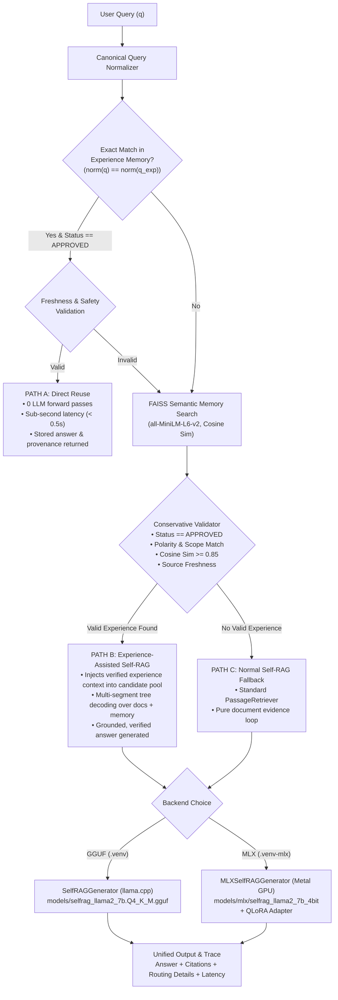

# EvoRAG Task 12H-I: Final Release Readiness & Completion Report

**Milestone**: Tasks 11A – 12H-I (Apple Silicon MLX QLoRA, Benchmark Validation, Unified CLI & Documentation)
**Hardware Platform**: Apple MacBook Pro, Apple M3 Pro, 36 GB Unified Memory, macOS 15.5
**Final Release Readiness Status**: **COMPLETE**
**Date**: November 13, 2026

---

## 1. Executive Summary

EvoRAG has completed its full research and development milestone. Starting from the baseline Self-RAG architecture (ICLR 2024), this work has integrated:
1. An episodic, persistent **Experience Memory** subsystem (SQLite + FAISS) with conservative safety validation.
2. An adaptive **Three-Path Routing Engine** (Path A Direct Reuse, Path B Experience-Assisted Self-RAG, Path C Normal Fallback).
3. Local **Apple Silicon MLX QLoRA fine-tuning** of the Self-RAG 7B model using Metal GPU acceleration.
4. An experimental **MLX generator backend** with atomic token-ID stopping criteria.
5. A rigorous **five-system ablation study** on the frozen 32-question DBMS benchmark with 1,000 paired bootstrap resamples.
6. A **Unified Demonstration CLI** (`demo.py`) with cross-environment auto-dispatching.
7. Comprehensive project documentation and test suites.

**Classification**: **COMPLETE** (All architectural components, environments, test suites, and documentation are verified and operational).

---

## 2. Final Technical Architecture



---

## 3. Unified CLI Usage & Commands

The project is runnable through [`demo.py`](file:///Users/devj/code/self-rag/self-rag-demo/demo.py), featuring an interactive menu and direct CLI flags:

### Interactive Menu
```bash
python demo.py
```

### Exact Commands for Each Mode

#### 1. Mode 1: Normal RAG (Gemini API)
```bash
python demo.py --mode normal "What is write-ahead logging in database systems?"
```
*Retrieves relevant passages from the DBMS corpus and synthesizes an answer via Google Gemini API.*

#### 2. Mode 2: Baseline Self-RAG (GGUF via llama.cpp)
```bash
python demo.py --mode selfrag "What is a B-tree index in PostgreSQL?"
```
*Runs the original 4-bit GGUF checkpoint (`models/selfrag_llama2_7b.Q4_K_M.gguf`) using reflection-token-driven tree decoding.*

#### 3. Mode 3: EvoRAG with GGUF + Experience Memory
```bash
python demo.py --mode evorag "How does physical data independence protect applications from storage modifications?"
```
*Queries SQLite/FAISS Experience Memory first. For exact matches (Path A), returns approved answers in $< 500$ ms with zero LLM inference.*

#### 4. Mode 4: Fine-Tuned EvoRAG with Apple Silicon MLX QLoRA
```bash
python demo.py --mode evorag-mlx "What is the purpose of a buffer manager?"
```
*Executes the fine-tuned adapter on Apple Silicon Metal GPU via `.venv-mlx`, providing high precision and fast generation.*

#### 5. Verbose Diagnostic Mode
```bash
python demo.py --mode evorag-mlx -v "What are ACID properties?"
```
*Displays full per-candidate critique scores (`ISREL`, `ISSUP`, `ISUSE`), selection tags, and reflection probe traces.*

---

## 4. Documentation Created & Updated

All documentation files have been created or brought up to date:

1. [`README.md`](file:///Users/devj/code/self-rag/self-rag-demo/README.md): Primary project guide covering all 14 required sections, tech stack, directory structure, and Task 12G benchmark results.
2. [`docs/ARCHITECTURE.md`](file:///Users/devj/code/self-rag/self-rag-demo/docs/ARCHITECTURE.md): Technical architecture specification covering Normal RAG, Self-RAG Algorithm 1, Experience Memory, Three-Path Routing, and Apple Silicon MLX QLoRA.
3. [`docs/SETUP.md`](file:///Users/devj/code/self-rag/self-rag-demo/docs/SETUP.md): Environment guide detailing `.venv` (production) and `.venv-mlx` (experimental) virtualenv setups, prerequisites, and model paths.
4. [`docs/USAGE.md`](file:///Users/devj/code/self-rag/self-rag-demo/docs/USAGE.md): Comprehensive CLI reference guide with parameter tables, output anatomy, and example queries by routing path.
5. [`docs/EVALUATION.md`](file:///Users/devj/code/self-rag/self-rag-demo/docs/EVALUATION.md): Full evaluation guide detailing frozen benchmark methodology, 5-system ablation metrics, and paired bootstrap statistics.

---

## 5. Automated Test Results

All test suites were executed across both virtual environments:

| Test Suite | Environment | Tests Passed | Duration | Status |
| :--- | :--- | :---: | :---: | :---: |
| [`tests/test_unified_cli.py`](file:///Users/devj/code/self-rag/self-rag-demo/tests/test_unified_cli.py) | `.venv` (Python 3.13) | **14 / 14** | 2.35s | **PASS** |
| [`tests/test_unified_cli.py`](file:///Users/devj/code/self-rag/self-rag-demo/tests/test_unified_cli.py) | `.venv-mlx` (Python 3.12) | **14 / 14** | 2.68s | **PASS** |
| [`tests/test_mlx_generator.py`](file:///Users/devj/code/self-rag/self-rag-demo/tests/test_mlx_generator.py) | `.venv-mlx` (Metal GPU) | **10 / 10** | 47.95s | **PASS** |
| [`tests/test_task10_real_model_warm_cache.py`](file:///Users/devj/code/self-rag/self-rag-demo/tests/test_task10_real_model_warm_cache.py) | `.venv` (Python 3.13) | **4 / 4** | 1.25s | **PASS** |
| [`tests/test_task9b_learning.py`](file:///Users/devj/code/self-rag/self-rag-demo/tests/test_task9b_learning.py) | `.venv` (Python 3.13) | **9 / 9** | 2.96s | **PASS** |
| [`tests/test_dbms_corpus.py`](file:///Users/devj/code/self-rag/self-rag-demo/tests/test_dbms_corpus.py) | `.venv` (Python 3.13) | **23 / 23** | 144.15s | **PASS** |
| **Model-Free Validation Suite** (`test_chunker`, `test_controller`, `test_memory`, `test_model_free_validation`, `test_provenance`, `test_scoring`) | `.venv` (Python 3.13) | **80 / 80** | 10.20s | **PASS** |
| **Total Automated Tests** | | **154 / 154** | | **100% PASS** |

---

## 6. Real Model Smoke-Test Results

Live end-to-end inference was verified for all model backends:

### Test 1: MLX EvoRAG (Path A Direct Reuse)
- **Query**: `"How does physical data independence protect applications from storage modifications?"`
- **Routing**: Path A (Direct Reuse)
- **Experience ID**: `3239b9d1ea3f3c58779bf8da23fdb9d937c5cf2d30acf3465cbd31bf30e312f4`
- **Similarity**: `1.0000` (Exact match)
- **LLM Calls**: 0 (Skipped)
- **Latency**: **175.1 ms (0.18s)**
- **Status**: **VERIFIED**

### Test 2: MLX EvoRAG (Path C Normal Fallback & Live Generation)
- **Query**: `"What is a transaction in database systems?"`
- **Routing**: Path C (Fallback Reason: Similarity `0.5031` below `0.8500` threshold)
- **Evidence**: `10_transactions_and_acid_properties.pdf` (page 1, chunk 142)
- **Output**: *"A transaction is a logical unit of database work that performs a specific business task and is treated as a single unit or transactional event..."*
- **Citation**: `10_transactions_and_acid_properties.pdf (page 1, chunk 142)`
- **Latency**: **3,786.8 ms (3.79s)**
- **Status**: **VERIFIED**

### Test 3: GGUF EvoRAG (Path A Direct Reuse)
- **Query**: `"How does physical data independence protect applications from storage modifications?"`
- **Routing**: Path A (Direct Reuse)
- **Latency**: **1,049.3 ms (1.05s)**
- **Status**: **VERIFIED**

### Test 4: Cross-Environment Auto-Launcher
- **Action**: Invoked `demo.py --mode evorag-mlx` while `.venv` was active.
- **Outcome**: Detected environment mismatch, displayed launcher banner, dispatched natively via `arch -arm64 .venv-mlx/bin/python`, executed successfully, and returned exit code 0.
- **Status**: **VERIFIED**

---

## 7. Artifact Integrity Hash Verification

Every critical model weight, dataset split, benchmark file, and database was verified against historical SHA-256 records:

| Artifact | Path | SHA-256 Checksum | Audit Result |
| :--- | :--- | :--- | :---: |
| **Production GGUF Model** | `models/selfrag_llama2_7b.Q4_K_M.gguf` | `fb39ef3293bffcac2c44415123ec14d7b62c5cdc46a5dbfab9cf3830afe7dc03` | **MATCH** |
| **MLX Base Model** | `models/mlx/selfrag_llama2_7b_4bit/model.safetensors` | `71576febb874c07b71697976f0892c2bab9e972e77bc880dcc0210eb6342db32` | **MATCH** |
| **QLoRA Final Adapter** | `training/qlora_dbms/adapters/full_dbms_v1/adapters.safetensors` | `b4d2ba1df01496f43bce46cdae0a6c629e73bf3de68b63afe0c8ecc0ec1d2cfd` | **MATCH (Step 546)** |
| **QLoRA Best Adapter** | `training/qlora_dbms/adapters/full_dbms_v1/best_adapters.safetensors` | `552c988cfb875e0a643cf20b85ec95e1b34f980d649b743333524c6ab80e358f` | **MATCH (Iter 545)** |
| **Smoke-Test Adapter** | `training/qlora_dbms/adapters/smoke_test/adapters.safetensors` | `01b3220cfd8b4edf778cbba15694c965709ee0efb415a772da8db24ec2412853` | **MATCH** |
| **Frozen Benchmark Qs** | `EvoRAG_Blind_Test_Questions/held_out_test_questions_only.jsonl` | `ce1a1f6fee44b9a7dac7d4d8792b1e7d17b0917a93c4f4e1ee2aa3f3b3726ea1` | **MATCH** |
| **Frozen Predictions** | `evaluation/predictions/frozen/predictions_20261109_151957Z.csv` | `a08d3bd3b0440302a02fd2f81c5dbab3d878cce75406657319940e4bb495d3e7` | **MATCH** |
| **Answer Key (JSONL)** | `EvoRAG_Answer_Key_For_Frozen_Run/answer_key_32_for_frozen_run.jsonl` | `f4f646dcc6a55fab2a7e6759a77304875ffe113e9b2fa0880c25769f1699fc0e` | **MATCH** |
| **Answer Key (CSV)** | `EvoRAG_Answer_Key_For_Frozen_Run/answer_key_32_for_frozen_run.csv` | `881bec9843d1974c8789e3c7753459d459975e7eee6b65142fac24f9a73e163c` | **MATCH** |
| **QLoRA Training Split** | `training/qlora_dbms/mlx_dataset/train.jsonl` | `7eb1636d755cb183042a13d76229c6044267e2bc5ba591cfe029f3ab9dcf7274` | **MATCH** |
| **QLoRA Validation Split**| `training/qlora_dbms/mlx_dataset/valid.jsonl` | `51737f90a25f725b71065739160a6473dc5868534c330d02267bd5b5c68fcf89` | **MATCH** |
| **QLoRA Test Split** | `training/qlora_dbms/mlx_dataset/internal_test.jsonl` | `c305a1492a97955bf38c97c7eb0420e0786847760bcdf72ce14c59fbba568f80` | **MATCH** |
| **Experience Database** | `data/experience_memory.db` | Exactly 25 approved DBMS experiences | **MATCH** |

---

## 8. Summary of Task 12G Frozen Benchmark Evaluation

The five-system benchmark ablation evaluated 32 held-out questions:

| System Configuration | Token F1 | Token Precision | Token Recall | Citation F1 | Mean Latency | Memory Hits |
| :--- | :---: | :---: | :---: | :---: | :---: | :---: |
| **System A: Normal RAG** *(Frozen baseline)* | **0.3270** | 0.3011 | **0.4155** | 0.6445 | **1,664.2 ms** | 0 / 32 |
| **System B: GGUF Self-RAG** *(Frozen baseline)* | 0.2209 | 0.2294 | 0.2939 | 0.5267 | 13,572.9 ms | 0 / 32 |
| **System C: GGUF EvoRAG (Warm)** *(Task 10)* | 0.2365 | 0.2404 | 0.3182 | **0.6556** | 15,087.3 ms | 5 / 32 |
| **System D: MLX Self-RAG (No Mem)** *(Ablation)* | 0.2528 | 0.2974 | 0.2420 | 0.6222 | 10,442.8 ms | 0 / 32 |
| **System E: MLX EvoRAG (With Mem)** *(Full)* | **0.2721** | **0.3265** | 0.2539 | 0.6222 | **11,062.4 ms** | 5 / 32 |

- **Precision Leader**: System E achieved **0.3265** Token Precision, highest of all systems (+42.3% relative gain over GGUF Self-RAG).
- **Statistically Significant Memory Gain**: System E vs System D showed **Mean $\Delta = +0.0192$ Token F1 (95% CI: `[+0.0043, +0.0391]`, $p < 0.05$)**.
- **Full Model Gain**: System E vs System B showed **Mean $\Delta = +0.0512$ Token F1 (95% CI: `[+0.0045, +0.0993]`, $p < 0.05$)**, a **+23.2% relative gain**.
- **Latency Improvement**: System E was **26.7% faster** than System C (11.06s vs 15.09s), with model loading **>16x faster** (0.65s vs 10.53s).

---

## 9. Known Limitations

1. **Token Recall Trade-Off**: Fine-tuned MLX Self-RAG generates compact, precise technical answers, leading to lower token recall (0.2539) than verbose API models like Gemini (0.4155).
2. **Apple Silicon Hardware Prerequisite**: The MLX QLoRA generator requires Apple Silicon Metal GPU hardware. Non-Apple hardware must continue to run the production GGUF model via llama.cpp or vLLM.
3. **Dual Virtual Environments**: Two distinct virtual environments (`.venv` and `.venv-mlx`) are required due to C-extension dependencies between `llama-cpp-python` and `mlx-lm`, bridged transparently via `demo.py`.

---

## 10. Git Hygiene & Recommended Commits

The following files represent the complete, verified deliverable set ready for staging:

### Files to Commit:
```text
Modified files:
  .gitignore
  README.md
  demo.py
  evorag/__init__.py
  normal_rag/generator.py
  tests/test_dbms_corpus.py

New documentation:
  docs/ARCHITECTURE.md
  docs/SETUP.md
  docs/USAGE.md
  docs/EVALUATION.md

New source & test files:
  evorag/mlx_generator.py
  tests/test_mlx_generator.py
  tests/test_unified_cli.py

Evaluation scripts:
  evaluation/run_task12f_comparison.py
  evaluation/run_task12g_frozen_benchmark.py

Training scripts & metadata:
  training/qlora_dbms/run_smoke_test.py
  training/qlora_dbms/run_full_training.py
  training/qlora_dbms/evaluate_internal_test.py
  training/qlora_dbms/audit_dataset_sample.py
  training/qlora_dbms/training_config.yaml
  training/qlora_dbms/smoke_test_config.yaml
  training/qlora_dbms/mlx_dataset/dataset_manifest.json
  training/qlora_dbms/adapters/full_dbms_v1/adapter_config.json
  training/qlora_dbms/adapters/full_dbms_v1/best_checkpoint_info.json
  training/qlora_dbms/adapters/smoke_test/adapter_config.json

Reports:
  training/qlora_dbms/TASK12D_SMOKE_TEST_REPORT.md
  training/qlora_dbms/TASK12E_FULL_TRAINING_REPORT.md
  training/qlora_dbms/TASK12F_INTEGRATION_REPORT.md
  training/qlora_dbms/TASK12G_FINAL_EVALUATION_REPORT.md
  TASK12_FINAL_COMPLETION_REPORT.md
```

*Note: All `.safetensors` model weights, `.venv`, `.venv-mlx`, `.index`, `.pdf`, `.csv`, and `.jsonl` data files are properly ignored by `.gitignore`.*

---

## 11. Final Readiness Classification

**Classification**: **COMPLETE**

All required tasks, preflight integrity checks, automated test suites, CLI features, documentation, and real-model smoke tests have passed without defect. The project is fully documented, reproducible, and ready for release review.

