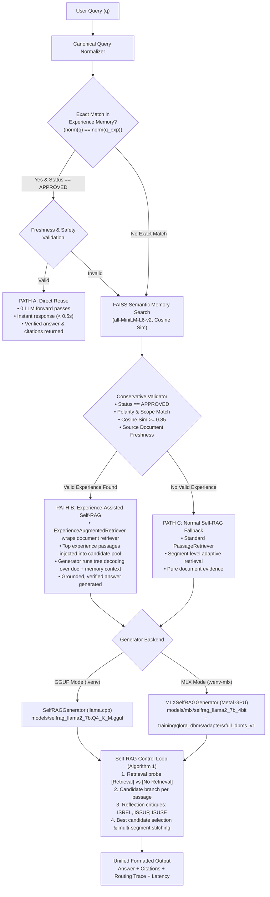

# EvoRAG Technical Architecture Specification

## 1. Architectural Overview

EvoRAG (Evolutionary Retrieval-Augmented Generation) couples adaptive, reflection-token-driven retrieval with an episodic Experience Memory subsystem and a domain-adapted Apple Silicon QLoRA generator.

---

## 2. Core Subsystems

### 2.1 Baseline Systems
1. **Normal RAG (`normal_rag/`)**:
   - Single-step retrieval via FAISS dense index.
   - External synthesis using Google Gemini API (`google-genai` SDK).
   - Fast, high recall, but lacks adaptive retrieval control and offline execution.
2. **Standard Self-RAG (`selfrag/`)**:
   - Implementation of Asai et al. (ICLR 2024), Algorithm 1.
   - Local 4-bit quantized Llama-2 7B model (`selfrag_llama2_7b.Q4_K_M.gguf`) executed via `llama-cpp-python`.
   - Adaptive retrieval tokens (`[Retrieval]`, `[No Retrieval]`, `[Continue to Use Evidence]`) and critique tokens (`[Relevant]`, `[Fully supported]`, `[Utility:N]`).

### 2.2 Experience Memory Subsystem (`evorag/memory/`)
1. **Relational Storage (`ExperienceStore`)**:
   - SQLite 3 database (`data/experience_memory.db`) serving as the single source of truth.
   - Stores approved experiences with fields: `experience_id`, `question`, `normalized_question`, `answer`, `evidence`, `source_versions`, `chunk_hashes`, `verification_status`, and timestamps.
2. **Dense Semantic Memory Index (`ExperienceRetriever`)**:
   - FAISS `IndexFlatIP` vector index (`data/experience_faiss.index`) indexed over question embeddings generated by `sentence-transformers/all-MiniLM-L6-v2`.
   - Stores L2-normalized 384-dimensional embeddings.
3. **Conservative Validator (`ExperienceValidator`)**:
   - Enforces a high similarity threshold ($\ge 0.85$).
   - Rejects unapproved experiences.
   - Verifies question polarity (negation words like *not*, *never*, *cannot* must match).
   - Verifies interrogative dimensions (*who*, *when*, *where*, *why*).
   - Verifies source document freshness against current document index chunk hashes.

### 2.3 Three-Path Routing Engine (`EvoRAGController`)
- **Path A (Direct Reuse)**:
  - Triggered when $\text{norm}(q) == \text{norm}(q_{\text{exp}})$ and validation passes.
  - Returns the stored answer immediately.
  - Zero LLM inference calls; latency $< 500$ ms.
- **Path B (Experience-Assisted Self-RAG)**:
  - Triggered when $\text{sim}(q, q_{\text{exp}}) \ge 0.85$ and validation passes.
  - Wraps the document retriever using `ExperienceAugmentedRetriever`.
  - Injects top validated experience passages alongside retrieved document chunks.
  - Generates a fresh, grounded answer using proven experience provenance.
- **Path C (Normal Self-RAG Fallback)**:
  - Triggered when memory misses or fails validation.
  - Executes standard document retrieval and reflection generation.

---

## 3. Apple Silicon MLX QLoRA Subsystem (`evorag/mlx_generator.py`)

To eliminate reliance on external GPU clouds and achieve high precision on technical DBMS queries, EvoRAG integrates an Apple Silicon Metal GPU backend using Apple's MLX framework:

### 3.1 Model Architecture & Quantization
- **Base Model**: `selfrag/selfrag_llama2_7b` converted to MLX 4-bit group-quantized weights (`models/mlx/selfrag_llama2_7b_4bit/`).
- **Vocabulary Preservation**: Exact 32,016-token vocabulary preserved, including all 16 atomic Self-RAG reflection tokens (IDs 32000–32015).
- **QLoRA Adapter**: Fine-tuned on 182 approved DBMS instruction-following examples across 13 core categories for 3 epochs (546 steps).
- **Adapter Location**: `training/qlora_dbms/adapters/full_dbms_v1/`.

### 3.2 Atomic Token-ID Stopping Criteria
Standard text-level stopping criteria risk truncating partial special tokens (e.g. stopping on `[` cuts `[Utility:5]` into `[`). `MLXSelfRAGGenerator` enforces atomic token-ID stopping:
1. **Utility Token Stopping**: Generation halts immediately upon emission of any token ID in $\{32007, 32008, 32009, 32010, 32011\}$ (`[Utility:1]` through `[Utility:5]`).
2. **Retrieval Probe Stopping**: Greedy initial probes halt immediately upon emitting token ID 32000 (`[No Retrieval]`) or 32001 (`[Retrieval]`).

### 3.3 Hardware Profile on Apple M3 Pro
- **Load Time**: 0.65s (compared to 10.53s for GGUF via llama.cpp).
- **Active Memory**: 3.79 GB Metal GPU allocation.
- **Inference Speed**: ~26.7% faster average latency than GGUF EvoRAG (11.06s vs 15.09s).

