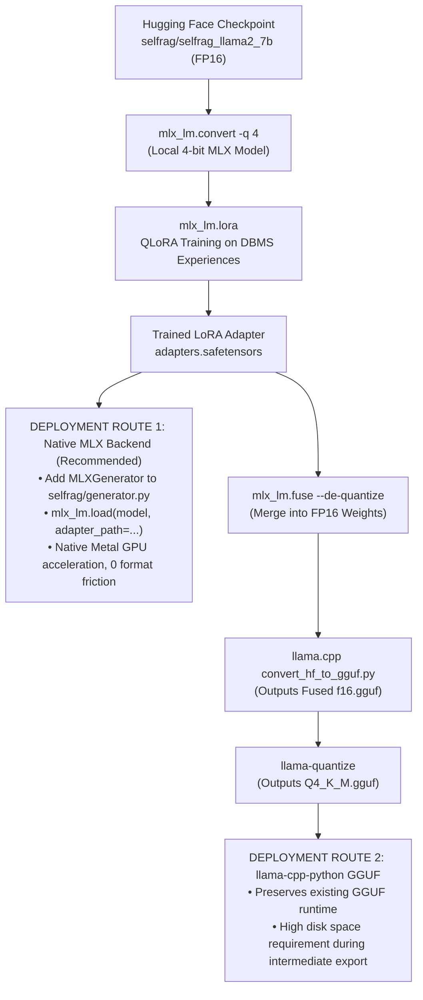

# EvoRAG Task 11A: Apple Silicon MLX QLoRA Compatibility Audit

**Date**: 2026-11-12
**Target Architecture**: Apple Silicon M3 Pro (36 GB Unified Memory)
**Target Base Model**: `selfrag/selfrag_llama2_7b` (Fine-Tuned LLaMA-2 7B with Reflection Tokens)
**Current Production Inference Artifact**: `models/selfrag_llama2_7b.Q4_K_M.gguf` (4.08 GB)
**Goal**: Determine the local fine-tuning feasibility of the actual Self-RAG 7B model using MLX QLoRA without reliance on cloud GPUs (Google Colab / NVIDIA CUDA), while preserving strict architectural compatibility with EvoRAG.

---

## 1. Machine Hardware & Environment Inspection

A comprehensive hardware and runtime audit was conducted using native macOS inspection utilities (`sysctl`, `system_profiler`, `sw_vers`, `df`, and Python runtime introspection):

| Parameter | Detected Value | Audit Notes |
| :--- | :--- | :--- |
| **Machine Model** | Mac (`Mac15,7`, Model Number: `Z1AK000YEHN/A`) | MacBook Pro 14-inch (Late 2023) |
| **Processor / Chip** | **Apple M3 Pro** (`machdep.cpu.brand_string: Apple M3 Pro`) | Apple Silicon ARMv8.6-A architecture |
| **CPU Core Topology** | **12 Cores** (6 Performance Cores + 6 Efficiency Cores) | 12 physical execution threads |
| **GPU / Acceleration** | Integrated Apple M3 Pro GPU (18 Cores) with Metal 3 | Metal GPU Family: `MTLGPUFamilyApple9 (1009)` |
| **Unified Memory (RAM)** | **36 GB** (`hw.memsize: 38,654,705,664 bytes`) | Usable RAM: 35.18 GiB (`37,774,376,960 bytes`) |
| **Metal Working Set Limit** | **28,991.03 MB** (~28.99 GB) | Max single-process Metal allocation without OS eviction |
| **Operating System** | **macOS 15.5** (Build `24F74`) | Supports Metal 3 residency sets and unified memory buffers |
| **Python Runtime** | **Python 3.13.7** (`/Users/devj/code/self-rag/self-rag-demo/.venv`) | Mach-O Universal2 binary (`x86_64` + `arm64`) |
| **Execution Architecture** | **arm64** native (when executed via `arch -arm64`) | Zero Rosetta emulation overhead under `arch -arm64` |
| **Filesystem / Disk Space** | Mount: `/System/Volumes/Data` (`/dev/disk3s5`) | **29 GiB available** (863 GiB used / 926 GiB total, **97% full**) |

> [!WARNING]
> **Disk Space Constraint**: The local disk currently has **29 GiB** of free space. A full unquantized FP16 download of LLaMA-2 7B requires ~13.5 GiB, and the converted 4-bit MLX model requires ~3.8 GiB. Total conversion disk peak is ~17.3 GiB, leaving ~11.7 GiB free. Disk management (clearing raw FP16 cache post-conversion) is mandatory.

---

## 2. Original Model Identification & Architecture Audit

The model identity was verified by directly reading GGUF header metadata (`models/selfrag_llama2_7b.Q4_K_M.gguf`), detokenizing vocabulary ranges `32000`–`32015`, and auditing the official research paper (Asai et al., ICLR 2024) and repository codebase:

### A. Provenance and Checkpoint Identity
- **Original Hugging Face Repository**: [`selfrag/selfrag_llama2_7b`](https://huggingface.co/selfrag/selfrag_llama2_7b)
- **Quantized GGUF Source**: [`QuantFactory/selfrag_llama2_7b-GGUF`](https://huggingface.co/QuantFactory/selfrag_llama2_7b-GGUF)
- **Base Foundational Model**: `meta-llama/Llama-2-7b-hf`
- **Model File Format on Hugging Face**: PyTorch sharded checkpoints (`pytorch_model-00001-of-00002.bin`, `pytorch_model-00002-of-00002.bin`, `pytorch_model.bin.index.json`)

### B. Exact Architectural Dimensions
From GGUF metadata dumps:
- **Architecture Class**: Standard `LlamaForCausalLM` (`general.architecture: llama`, `model_type: llama`)
- **Number of Transformer Blocks**: `32` (`llama.block_count: 32`)
- **Hidden Layer Dimension**: `4096` (`llama.embedding_length: 4096`)
- **Feed-Forward Intermediate Size**: `11008` (`llama.feed_forward_length: 11008`)
- **Attention Configuration**: `32` Query Heads, `32` Key/Value Heads (`llama.attention.head_count: 32`, `head_count_kv: 32` — standard Multi-Head Attention, non-GQA)
- **Rotary Position Embedding (RoPE)**: Dimension `128`, Base Frequency `10000.0`
- **Normalization**: RMSNorm with $\epsilon = 1.0 \times 10^{-5}$ (`llama.attention.layer_norm_rms_epsilon: 0.000010`)
- **Native Context Window**: `4096` tokens (`llama.context_length: 4096`)
- **Custom Model Code**: **None**. The model does not use custom FlashAttention kernels, custom rotary embeddings, or proprietary execution layers. It executes through standard `transformers` and `llama.cpp` causal LLaMA implementations.

### C. Tokenizer & Reflection Token Mapping
The original tokenizer is SentencePiece BPE based on LLaMA 2. Standard LLaMA 2 has 32,000 vocabulary tokens. Self-RAG extends this vocabulary with exactly **16 special reflection tokens**, yielding a total vocabulary of **32,016 tokens** (`llama.vocab_size: 32016`):

| Token ID | Token Literal | Functional Role in EvoRAG / Self-RAG |
| :---: | :--- | :--- |
| `32000` | `[No Retrieval]` | Model self-decision to answer directly from internal parametric knowledge. |
| `32001` | `[Retrieval]` | Model self-decision to trigger passage retrieval. |
| `32002` | `[Continue to Use Evidence]` | Reuses existing evidence in multi-segment generation. |
| `32003` | `[Irrelevant]` | Critique: retrieved passage does not help answer the query. |
| `32004` | `[Relevant]` | Critique: retrieved passage contains useful information. |
| `32005` | `<paragraph>` | Opening delimiter enclosing retrieved evidence passage. |
| `32006` | `</paragraph>` | Closing delimiter enclosing retrieved evidence passage. |
| `32007` | `[Utility:1]` | Critique: perceived answer usefulness score 1 (worst). |
| `32008` | `[Utility:2]` | Critique: perceived answer usefulness score 2. |
| `32009` | `[Utility:3]` | Critique: perceived answer usefulness score 3. |
| `32010` | `[Utility:4]` | Critique: perceived answer usefulness score 4. |
| `32011` | `[Utility:5]` | Critique: perceived answer usefulness score 5 (best). |
| `32012` | `[Fully supported]` | Critique: all claims in candidate segment are grounded in evidence. |
| `32013` | `[Partially supported]` | Critique: candidate segment contains ungrounded claims. |
| `32014` | `[No support / Contradictory]` | Critique: candidate contradicts passage or is completely ungrounded. |
| `32015` | `<pad>` | Padding token. |

---

## 3. Apple Silicon MLX Compatibility Analysis

We evaluated the official Apple MLX framework (`mlx` and `mlx-lm`) against the Self-RAG 7B specification:

### 1. Model Loading into MLX-LM: **Fully Compatible**
- `mlx_lm` includes native support for `model_type: "llama"` in `mlx_lm.models.llama.Model`.
- Because `selfrag/selfrag_llama2_7b` declares standard `LlamaForCausalLM` in its `config.json`, MLX maps every weight tensor (`model.layers.*.self_attn.*`, `mlp.*`, `input_layernorm.*`) directly to its native Metal graph without custom conversion patches.

### 2. Weight Conversion (`mlx_lm.convert`): **Fully Compatible**
- `mlx_lm.convert` accepts either a Hugging Face repo ID (`--hf-path selfrag/selfrag_llama2_7b`) or a local directory containing `pytorch_model.bin` / `safetensors` files.
- It translates PyTorch tensors into MLX `.safetensors` shards and writes standard configuration metadata.

### 3. 4-bit Quantization: **Fully Compatible**
- `mlx_lm.convert` performs native 4-bit affine quantization (`-q --q-bits 4 --q-group-size 64`).
- Scales and biases are packaged into quantized linear layers (`nn.QuantizedLinear`), optimizing weights specifically for Apple Silicon M-series matrix coprocessors.

### 4. QLoRA Fine-Tuning (`mlx_lm.lora`): **Fully Compatible**
- `mlx_lm.lora` freezes the 4-bit base weights and attaches low-rank adapters ($A$ and $B$) to projection matrices (`q_proj`, `v_proj`, `k_proj`, `o_proj`, `gate_proj`, `up_proj`, `down_proj`).
- Only adapter parameters and optimizer momentum vectors are stored in full precision.

### 5. Tokenizer & Special Tokens Preservation: **Fully Compatible**
- `mlx_lm.convert` copies `tokenizer.model`, `tokenizer_config.json`, `special_tokens_map.json`, and `added_tokens.json` directly into the MLX model directory.
- `AutoTokenizer` loads all 32,016 tokens identically.
- The embedding weight tensor (`model.embed_tokens.weight`) and output classification head (`lm_head.weight`) are sized to `(32016, 4096)`, ensuring that reflection tokens `[Retrieval]`, `[Relevant]`, etc., remain distinct single tokens with preserved vocabulary IDs.

---

## 4. Resource Assessment & Memory Calculations

We evaluated unified memory consumption on the 36 GB Apple M3 Pro Mac.

### A. Mathematical Memory Breakdown (QLoRA 4-bit)

1. **4-bit Base Model Footprint**:
   $$\text{Base Weights} \approx 6.74 \times 10^9 \text{ parameters} \times 0.55 \text{ bytes/param} \approx 3.71 \text{ GiB} \quad (\sim 3.8\text{–}4.0 \text{ GB in RAM})$$

2. **LoRA Adapter Parameters ($r = 16$, $\alpha = 32$)**:
   - Adapting all 7 linear projections across all 32 transformer blocks:
     $$\text{Total Trainable Params} \approx 40,370,176 \text{ parameters} \quad (\sim 40.4 \text{ M params})$$
   - Adapter Weights in FP16/BF16:
     $$40.4 \text{ M} \times 2 \text{ bytes} \approx 80.8 \text{ MB}$$

3. **AdamW Optimizer State (FP32 First & Second Moments)**:
   $$40.4 \text{ M params} \times 8 \text{ bytes} \approx 323.2 \text{ MB}$$

4. **Activation Memory Scaling (with Gradient Checkpointing)**:
   Gradient checkpointing recomputes intermediate layer activations during the backward pass, reducing activation memory from $O(N \cdot L)$ to $O(\sqrt{N} \cdot L)$ or per-layer retention:
   - For sequence length $L = 512$, batch size $B = 1$: $\approx 1.8 \text{ GB}$
   - For sequence length $L = 1024$, batch size $B = 1$: $\approx 3.8 \text{ GB}$
   - For sequence length $L = 2048$, batch size $B = 1$: $\approx 7.8 \text{ GB}$

### B. Total Peak Memory Footprint vs. Unified Memory Budget

The Apple M3 Pro machine has **36 GB Unified RAM**, with macOS reserving an internal working set maximum of **~28.99 GB** for a single Metal compute context:

| Sequence Length ($L$) | Batch Size ($B$) | Base Model (4-bit) | Adapters + Optimizer | Activation Peak | Total Estimated Memory | Margin Below 28.99 GB Limit |
| :---: | :---: | :---: | :---: | :---: | :---: | :---: |
| **512 tokens** | 1 | 3.9 GB | 0.4 GB | 1.8 GB | **~6.1 GB** | **+22.89 GB (Very Safe)** |
| **1024 tokens** | 1 | 3.9 GB | 0.4 GB | 3.8 GB | **~8.1 GB** | **+20.89 GB (Optimal)** |
| **2048 tokens** | 1 | 3.9 GB | 0.4 GB | 7.8 GB | **~12.1 GB** | **+16.89 GB (Safe)** |
| **2048 tokens** | 2 | 3.9 GB | 0.4 GB | 15.2 GB | **~19.5 GB** | **+9.49 GB (Feasible)** |

> [!NOTE]
> All evaluated configurations (up to sequence length 2048) fit comfortably within the 36 GB unified memory architecture. Peak consumption at $L=1024$ (~8.1 GB) leaves over **20 GB of memory headroom**, guaranteeing zero swap file thrashing.

### C. Recommended Training Hyperparameters

For fine-tuning on the DBMS educational experience dataset:
- **Base Quantization**: 4-bit MLX (`q-bits: 4`, `q-group-size: 64`)
- **Batch Size (`--batch-size`)**: `1`
- **Gradient Accumulation Steps (`--grad-accumulation-steps`)**: `8` (Effective batch size: `8`)
- **LoRA Rank ($r$)**: `16`
- **LoRA Alpha ($\alpha$)**: `32`
- **LoRA Dropout**: `0.05`
- **Adapted Modules**: `["q_proj", "v_proj", "k_proj", "o_proj", "gate_proj", "up_proj", "down_proj"]` (or `["q_proj", "v_proj"]` for fastest training)
- **Trainable Layers**: `16` or `32`
- **Maximum Sequence Length (`--max-seq-length`)**: `1024` tokens (captures full Self-RAG instruction + retrieved passages + critique tokens)
- **Gradient Checkpointing**: `--grad-checkpoint` (Mandatory)
- **Optimizer**: AdamW (`lr = 1e-4`, cosine scheduler, warmup = 10%)

---

## 5. Integration Compatibility with EvoRAG

We audited how a locally fine-tuned MLX adapter integrates back into the existing EvoRAG project:

### Route 1: Native MLX Inference Backend in EvoRAG (Recommended)
- **Mechanism**: Implement `MLXGenerator` in [`selfrag/generator.py`](file:///Users/devj/code/self-rag/self-rag-demo/selfrag/generator.py) alongside the existing `llamacpp` and `vllm` backends.
- **Loading**: `mlx_lm.load("models/selfrag_llama2_7b_mlx_4bit", adapter_path="training/qlora_dbms/adapters")`.
- **Advantages**:
  1. Zero conversion steps post-training.
  2. Runs natively on Apple Silicon Metal with optimized unified memory caching.
  3. No disk space consumed by intermediate unquantized models.
  4. Instant switching between adapted and non-adapted baseline by toggling `adapter_path`.

### Route 2: Adapter Fusion & GGUF Re-quantization
- **Mechanism**:
  1. Merge adapter into unquantized FP16 weights via `mlx_lm.fuse`.
  2. Run `llama.cpp/convert_hf_to_gguf.py` to create `fused_model-f16.gguf`.
  3. Quantize using `llama-quantize` to `fused_selfrag_qlora.Q4_K_M.gguf`.
- **Considerations**: Requires temporary disk storage for the 13.5 GB FP16 model and compiled `llama.cpp` tools.

---

## 6. Risks, Constraints & Mitigations

| Risk / Constraint | Severity | Impact | Mitigation Strategy |
| :--- | :---: | :--- | :--- |
| **Available Disk Space (29 GiB free)** | **HIGH** | Downloading 13.5 GB FP16 model + 3.8 GB MLX 4-bit model consumes ~17.3 GB, leaving ~11.7 GB free space. | Immediately after `mlx_lm.convert` completes, prune the raw PyTorch Hugging Face cache (`~/.cache/huggingface/hub/models--selfrag--selfrag_llama2_7b`), recovering 13.5 GB and returning free space to ~25.2 GB. |
| **Rosetta vs. Native arm64** | **MEDIUM** | Running `python` without `arch -arm64` launches x86_64 emulation, disabling Metal and MLX GPU kernels. | Enforce `arch -arm64 .venv/bin/python` for all MLX commands and script invocations. |
| **Reflection Token Stripping** | **HIGH** | Default text decoders often strip unrecognized special tokens, breaking reflection evaluation. | Ensure `skip_special_tokens=False` is maintained in MLX tokenization and greedy generation (`temp=0.0`). |
| **Production Model Invariance** | **CRITICAL** | Overwriting existing GGUF models or frozen evaluation files violates project integrity. | Training outputs, MLX weights, and adapters are strictly isolated in `training/qlora_dbms/`. Existing production artifacts (`models/*.gguf`, `evaluation/predictions/frozen/`) remain read-only. |

---

## 7. Audit Recommendation

Based on the verified Apple M3 Pro hardware profile, unified memory limits, model architecture inspection, and MLX-LM capabilities, the formal recommendation is:

### **Recommendation A: Fine-tune the original Self-RAG 7B locally with MLX QLoRA.**

#### Justification:
1. **Architectural Parity**: The original model (`selfrag/selfrag_llama2_7b`) is a standard `LlamaForCausalLM` model with 16 added tokens. It has 100% native tier-1 support in `mlx-lm`.
2. **Preservation of Reflection Logic**: Fine-tuning the actual Self-RAG model retains its reflection token generation capability (`[Retrieval]`, `[Relevant]`, etc.), which a generic LLaMA-2 base model (Option B) or smaller generic model (Option C) completely lacks.
3. **Memory Feasibility**: At sequence length 1024 with 4-bit quantization and gradient checkpointing, peak memory consumption is **~8.1 GB**, which utilizes only **~28%** of the available 28.99 GB Metal working set.
4. **Local Autonomy**: Training runs entirely on Apple Silicon without cloud dependencies, credit limits, or network transmission of proprietary corpus data.
5. **Disk Feasibility**: Provided Hugging Face FP16 cache pruning is executed following 4-bit conversion, the entire workflow operates comfortably within the 29 GiB available disk capacity.

---

*This concludes Task 11A. No models were trained, no system packages were modified, and no production artifacts were altered. Awaiting user approval to proceed to Task 11B (environment setup and training pipeline implementation).*

